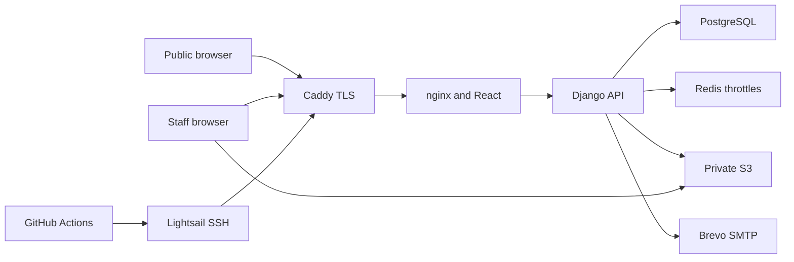

# RageZine portal threat model

Reviewed `codex/submission-iteration` on 2026-11-16. This model covers the code in this worktree. It does not verify the live server or cloud account.

## Executive summary

The main risks are loss of service from large public uploads and loss of private submissions through a staff account. This branch fixes the earlier name-and-email takeover path: each public request now creates a separate record. A manager role now guards deletion and full exports, but all staff get that role at first by request. The repo has no second factor for staff login or malware scan for uploads.

## Scope and assumptions

- **In scope:** the React form and staff pages, Django API, Caddy, nginx, PostgreSQL, Redis, S3 storage settings, Brevo SMTP path, and GitHub Actions deployment. Evidence: `frontend/ragezine-portal/src/`, `backend/submissions/api/`, `docker-compose.yml`, `.github/workflows/ci-cd.yml`.
- **Usage:** a public art submission portal with about 1,000 total submissions, based on the project context. The submitted work and artist contact data are private until staff choose to publish them. Evidence for the data fields: `backend/submissions/models.py`; evidence for staff access: `backend/submissions/api/submission_views.py:65-79`.
- **Deployment status:** the user confirmed that this second-iteration worktree is still local. A merge to `main` starts deployment to one Lightsail VM. Evidence: `.github/workflows/ci-cd.yml:1-9` and `:85-153`; `docs/decisions.md` D-11. The live cloud settings were not checked.
- **Storage assumption:** production uses a private S3 bucket and a dedicated app key. The deploy script requires S3 settings, but the bucket policy and key rights are outside the repo. Evidence: `ops/deploy-lightsail.sh:23-37`; `backend/ragezine_portal/settings.py:211-236`.
- **Staff policy:** the user confirmed that all staff should have deletion and full export access at first. The `Submission Managers` group now holds those permissions. An account can become reviewer-only when a superuser removes that group. Evidence: `backend/submissions/api/permissions.py`, `backend/submissions/migrations/0018_staff_manager_role.py`, `docs/staff-roles.md`.
- **Open question:** Is S3 versioning or a tested restore path active? This answer can change the impact of deletion.

## System model

### Primary components

- Caddy terminates public TLS, then sends traffic to nginx. nginx serves React and forwards API traffic to Gunicorn/Django. Evidence: `frontend/ragezine-portal/Caddyfile`, `frontend/ragezine-portal/nginx.conf:38-114`, `docker-compose.yml:1-16` and `:68-102`.
- Django saves artist and work records in PostgreSQL, uses Redis for shared rate limits, saves uploads in S3 in production, and sends receipts through SMTP. Evidence: `docker-compose.yml:19-65`, `backend/ragezine_portal/settings.py:99-129` and `:171-236`, `backend/submissions/api/email.py:65-118`.
- GitHub Actions checks code on pull requests. A push to `main` sends a source archive over SSH and runs the deploy script. Evidence: `.github/workflows/ci-cd.yml:1-9` and `:85-153`, `ops/deploy-lightsail.sh:39-58`.

### Data flows and trust boundaries

1. **Public browser → Caddy → nginx → Django:** HTTPS brings form fields, links, and files across the public boundary. nginx applies body, rate, and connection limits. Django checks fields, URLs, file types, counts, and sizes after parsing. Evidence: `frontend/ragezine-portal/nginx.conf:32-35` and `:38-86`, `backend/submissions/serializers.py:40-63` and `:443-521`.
2. **Staff browser → Django:** A password and session cookie allow review, votes, tags, and comments. Deletion and full exports also require manager permissions. Login uses CSRF and rate limits. Evidence: `backend/submissions/api/auth.py:28-56`, `backend/submissions/api/permissions.py`, `backend/submissions/api/downloads.py`.
3. **Django → PostgreSQL and Redis:** Django writes private records to PostgreSQL. Redis stores shared throttle data. Both services stay on the Compose network; only Caddy and a loopback nginx port are published. Evidence: `docker-compose.yml:19-65` and `:83-102`, `backend/ragezine_portal/settings.py:99-129`.
4. **Django → S3 and SMTP:** The backend uses app credentials from its private environment for uploads and sends receipt email to the submitted address. Staff video playback can use a one-hour signed S3 URL. Evidence: `docker-compose.yml:52-59`, `backend/ragezine_portal/settings.py:211-236`, `backend/submissions/api/previews.py:38-91`, `backend/submissions/api/email.py:65-118`.
5. **GitHub Actions → Lightsail:** A merge to `main` crosses a release boundary through SSH. The server reads its own private `.env`; GitHub holds SSH credentials. Evidence: `.github/workflows/ci-cd.yml:85-153`, `ops/deploy-lightsail.sh:11-15` and `:39-58`.

#### Diagram

## Assets and security objectives

| Asset | Why it matters | Security objective |
| --- | --- | --- |
| Artist identity, contact data, messages, and works | Disclosure or change can harm artists and the review process. `backend/submissions/models.py` | C, I |
| Uploaded files in S3 | Files can be private, large, or unsafe to open. `backend/submissions/models.py:9-16`, `backend/submissions/utils/uploads.py` | C, I, A |
| Staff sessions and roles | They control all review data and destructive actions. `backend/submissions/api/auth.py`, `backend/submissions/api/submission_views.py:65-79` | C, I |
| Django, S3, SMTP, and SSH secrets | Theft can expose data or change releases. `backend/ragezine_portal/settings.py:14-17` and `:171-236`, `.github/workflows/ci-cd.yml:85-95` | C, I |
| VM disk, database, and release path | Exhaustion or loss can stop the portal. `docker-compose.yml:19-28` and `:68-72`, `ops/deploy-lightsail.sh:39-58` | A, I |

## Attacker model

### Capabilities

- An unauthenticated person can send form data, public HTTPS links, and large files to both create endpoints. They can request a receipt to an address they enter. Evidence: `backend/submissions/api/submission_views.py:71-79` and `:121-259`.
- An attacker with a staff password and a valid session can use staff API actions. A malicious sender can try to persuade staff to open a file or external link. Evidence: `backend/submissions/api/auth.py:28-56`, `backend/submissions/api/downloads.py:384-456`, `frontend/ragezine-portal/src/pages/SubmissionDetailsPage.jsx:178-185`.
- An attacker who gains a GitHub deployment secret or the server deployment account could replace a release. This needs a separate credential or account compromise. Evidence: `.github/workflows/ci-cd.yml:85-153`.

### Non-capabilities

- A public form caller has no direct permission to list, read, update, or delete an older submission. The current create helper always makes a new record. Evidence: `backend/submissions/api/submission_views.py:47-56` and `:71-79`; `backend/submissions/test_batch.py`.
- A submitted link is stored and shown to staff; the server does not fetch it. This path does not give the sender a server-side fetch primitive. Evidence: `backend/submissions/serializers.py:40-63`, `backend/submissions/api/submission_views.py:148-156`.

## Entry points and attack surfaces

| Surface | How reached | Trust boundary | Notes | Evidence |
| --- | --- | --- | --- | --- |
| Single and batch form | Public POST | Internet → API | JSON/form parts, links, files; new record per request | `backend/submissions/api/submission_views.py:121-259` |
| Staff and admin login | Public POST | Internet → auth | Password, CSRF, rate limits; no repo second factor | `backend/submissions/api/auth.py:28-56`; `backend/ragezine_portal/urls.py:5` |
| Review API | Session request | Staff browser → API | List, detail, tags, comments, votes, update, delete | `backend/submissions/api/submission_views.py:65-79` and `:261-347` |
| File preview and signed video | Staff GET | API → S3 or file parser | Inline content and one-hour signed S3 links | `backend/submissions/api/previews.py:38-91` and `:137-217` |
| Exports and original files | Staff GET | API → S3 and disk | Full ZIP uses temporary disk | `backend/submissions/api/downloads.py:303-318` and `:384-456` |
| SMTP receipt | After public POST | API → mail provider | Submitted address controls recipient | `backend/submissions/api/email.py:65-118` |
| Release pipeline | Merge to `main` | GitHub → SSH → VM | SSH key and source archive are high-value | `.github/workflows/ci-cd.yml:85-153`; `ops/deploy-lightsail.sh:39-58` |

## Top abuse paths

1. **Exhaust VM disk:** Send one or two requests near the 11 GiB edge limit. nginx and Django buffer data before Django checks per-file totals. The VM can run out of temporary space. See TM-001.
2. **Read private submissions:** Steal a staff password, create a session, then use the complete export or per-file download endpoints. See TM-002.
3. **Destroy review data:** Use a stolen or misused staff session to call the `destroy` action for many submissions; the handler deletes database rows and S3 objects. See TM-003.
4. **Deliver a harmful file:** Submit a file that passes a basic signature check, then induce staff to download and open it in a local viewer. See TM-004.
5. **Lure staff to an external page:** Submit a public HTTPS link with a work. Staff may open it while reviewing and enter credentials on a fake page. See TM-005.
6. **Replace a release:** Steal a GitHub deployment secret or compromise a merge path, then use the SSH release path to deploy hostile code. See TM-006.
7. **Send unwanted receipts:** Submit a false email address repeatedly within rate limits. The portal sends receipts to that address and uses SMTP quota. See TM-007.

## Threat model table

| Threat ID | Threat source | Prerequisites | Threat action | Impact | Impacted assets | Existing controls (evidence) | Gaps | Recommended mitigations | Detection ideas | Likelihood | Impact severity | Priority |
| --- | --- | --- | --- | --- | --- | --- | --- | --- | --- | --- | --- | --- |
| TM-001 | Public caller | Can reach form API | Send large or slow uploads | Full disk stops service | VM disk, database availability | 11 GiB edge cap; two active uploads; 5 GiB file limit (`nginx.conf:43,72-80`; `settings.py:132-137`) | Limits apply before and after separate buffers; no temporary disk quota | Put nginx and Django temporary files on bounded storage; alert on space; plan direct private S3 upload | Disk space, 413/429 counts, upload duration | High: public endpoint and allowed size | High: one VM can stop | high |
| TM-002 | Stolen staff session | Valid staff login | Export all submissions and files | Broad privacy loss | Artist data, files | Staff and manager permission checks; secure cookies (`api/permissions.py`; `settings.py:20-24`) | All staff start in manager group; no second factor in repo | Remove manager role where unneeded; add second factor; log exports | Large export alerts, unusual login and download volume | Medium: needs credential theft | High: all data may leave | high |
| TM-003 | Staff account misuse | Valid staff login | Delete submissions and stored files | Loss of work and review state | PostgreSQL rows, S3 files | Manager delete permission (`api/permissions.py`; `submission_views.py:71-77`) | All staff start in manager group; backup status is unknown | Remove manager role where unneeded; keep backups and S3 versioning | Per-user delete audit and burst alerts | Medium: needs staff access | High: destructive | high |
| TM-004 | Public sender | Staff opens original file | Place a harmful document in a submission | Staff device or data may be harmed | Staff workstation, portal data | Extension and signature checks; private download (`uploads.py:26-67`; `downloads.py:384-405`) | No scan or quarantine in repo | Scan before staff download; show safe previews first | Scan results, download log, incident reports | Medium: needs staff action | High if viewer is compromised | medium |
| TM-005 | Public sender | Staff opens a work link | Link to a fake login or hostile site | Staff credential theft | Staff sessions | HTTPS and public-host URL checks; new tab uses `noopener` (`serializers.py:40-63`; `SubmissionDetailsPage.jsx:183-184`) | HTTPS does not prove a site is safe | Show external-site warning or domain; train staff; use second factor | Reported links and new login location alerts | Medium: staff review links | Medium to high | medium |
| TM-006 | Credential or repo compromise | Access to deploy secret or merge rights | Send hostile release over SSH | Full app and data compromise | VM, secrets, database, S3 | Main-only deploy, CI checks, known hosts (`ci-cd.yml:85-153`) | Key scope and branch protection are not visible in repo | Protect `main`; limit deploy key rights; rotate key on exposure; pin release actions after review | Audit merges, deploys, SSH access | Low: separate compromise needed | High: full control | medium |
| TM-007 | Public caller | Can submit a valid form | Use someone else's address for receipt | Unwanted mail and quota use | SMTP quota, sender reputation | Form and IP rate limits (`submission_views.py:71-79`; `settings.py:124-128`) | Email ownership is not checked | Add mail abuse alerts; consider challenge only if abuse occurs | Receipt volume, bounces, SMTP errors | Medium: public form | Low at this scale | low |

## Criticality calibration

- **Critical:** a public request can read all artist work, or can run code on the VM without staff action. No such path is confirmed in this worktree.
- **High:** a public upload can stop the one VM; a lost staff session can export or delete all records. See TM-001 to TM-003.
- **Medium:** a harmful file needs staff to open it; an external link needs staff to trust it; a deployment attack needs separate GitHub or SSH access. See TM-004 to TM-006.
- **Low:** receipt abuse within the current rate limits, or exposure of low-sensitivity route names. See TM-007.

## Focus paths for security review

| Path | Why it matters | Related Threat IDs |
| --- | --- | --- |
| `frontend/ragezine-portal/nginx.conf` | Enforces public body, rate, and connection limits. | TM-001, TM-002 |
| `backend/submissions/api/submission_views.py` | Owns public creation and staff actions, including deletion. | TM-001, TM-003, TM-007 |
| `backend/submissions/serializers.py` | Checks public fields, links, and file totals. | TM-001, TM-005 |
| `backend/submissions/utils/uploads.py` | Checks uploaded file names and signatures. | TM-004 |
| `backend/submissions/api/auth.py` | Starts staff sessions. | TM-002, TM-003 |
| `backend/submissions/api/downloads.py` | Provides full and per-file exports. | TM-002, TM-004 |
| `backend/submissions/api/previews.py` | Parses previews and issues signed video links. | TM-002, TM-004 |
| `backend/ragezine_portal/settings.py` | Holds cookie, throttle, storage, and mail settings. | TM-001, TM-002, TM-007 |
| `.github/workflows/ci-cd.yml` | Controls tests and production SSH deployment. | TM-006 |
| `ops/deploy-lightsail.sh` | Unpacks and starts each server release. | TM-006 |

## Quality check

- Covered public create, login, admin, staff API, file preview and export, SMTP receipt, and CI deployment entry points.
- Tied each runtime and release boundary to at least one abuse path; kept CI separate from runtime.
- Used the user's answers for branch state and staff policy. Cloud settings and backups remain unverified.
- Did not copy secret values or claim to verify the live server.
